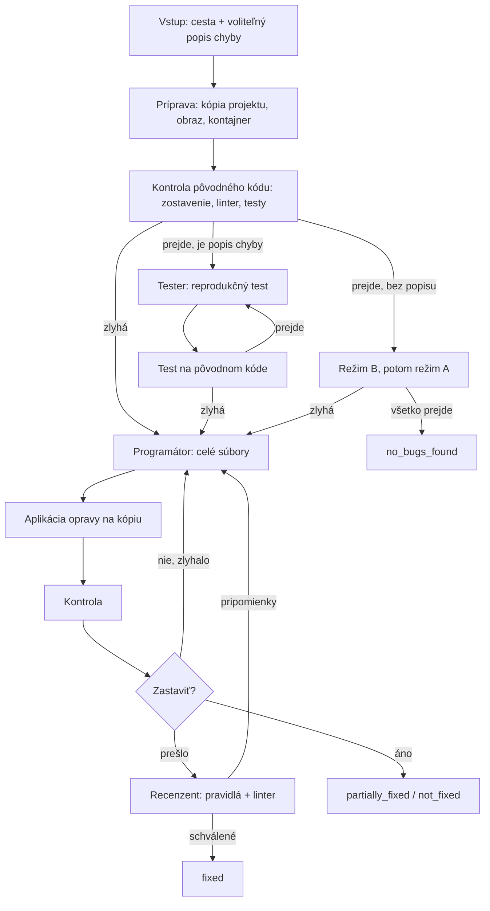

# Patchloop: špecifikácia

Verzia 24. 10. 2026. Zdroj pravdy pre architektonické rozhodnutia; pôvodný plán je v lokálnom súbore `PLAN.md` (nie je v repozitári). Zmeny rozhodnutí sa zapisujú do [`DECISIONS.md`](DECISIONS.md). Sekciu «Zafixované rozhodnutia» nemeníme bez výslovného súhlasu autora.

Typ práce: semestrálny projekt (dva semestre). Výskumná časť sa nerobí; dôležitý je funkčný, ukázateľný systém.

## 1. Cieľ, používateľ a hranice

**Cieľ.** Pre Python projekt (voliteľne s popisom chyby) systém autonómne nájde chybu a vytvorí opravu: zostaví kód, spustí testy, opraví podľa chybovej správy a výsledok overí. Výstupom je oprava (diff), vysvetlenie a záznam behu.

**Používateľ** je vývojár, ktorý chce rýchlo opraviť chybu v svojom projekte a nechce posielať kód do cloudu: model beží lokálne.

**Čo systém robí:**
- opravuje chyby zistiteľné zostavením, testami alebo statickou analýzou v Python projektoch (Django, FastAPI),
- spúšťa cudzí a generovaný kód výlučne v izolovanom kontajneri bez siete,
- vždy vráti čestný výsledok: `fixed` / `partially_fixed` / `not_fixed` / `no_bugs_found`.

**Čo systém nerobí:**
- nemení pôvodný projekt (pracuje na kópii; úpravu aplikuje používateľ samostatným príkazom),
- nerieši chyby závislé od externých služieb (databáza, Redis, fronty), súbehu alebo výkonu (v prvej verzii),
- nerobí `git push` ani nevytvára pull requesty,
- neposiela kód ani dáta do externých služieb: všetko beží lokálne (Ollama).

## 2. Zafixované rozhodnutia

| Otázka | Rozhodnutie |
| --- | --- |
| Typ práce | Semestrálny projekt na dva semestre, bez výskumnej časti |
| Jazyk | Implementácia a overenie len pre Python (Django, FastAPI); architektúra jazykovo nezávislá cez profil jazyka. *Čaká na odsúhlasenie s vedúcim* |
| Agenti | Programátor, Tester, Recenzent; nevolajú sa navzájom, pracujú so spoločným stavom, riadenie odovzdáva graf (LangGraph) |
| Model | Lokálny, cez Ollama a LiteLLM; výber po testoch na vlastných projektoch |
| Pieskovisko | Jednorazový Docker kontajner bez siete, s limitmi; závislosti v obraze pripravenom vopred |
| Konfigurácia projektu | `patchloop.yml` + automatická detekcia (profil Python) |
| Vstup | CLI: cesta k projektu + voliteľný popis chyby |
| Výstup | Diff a vysvetlenie; pôvodný projekt sa nemení. `patchloop apply` vytvorí vetvu git s opravou (bez commitu a pushu) |
| Zastavenie cyklu | Limit iterácií, detekcia stagnácie, časový limit, rollback na najlepší pokus |
| Testy | Existujúce testy; Tester dopĺňa; test musí zlyhať pred opravou; dva režimy bez testov (B: zostavenie a linter, A: základné testy) |
| Kontext | Sedem zdrojov (sekcia 7), implementovaných postupne podľa priority |
| Rozhranie | Terminál (Typer + Rich) naživo + HTML správa po behu |
| Dáta | SQLAlchemy 2 + PostgreSQL (docker compose), Alembic; pgvector pre RAG |
| Jazyky textov | Kód, identifikátory, komentáre, commity: angličtina. Dokumentácia (`PLAN.md`, `docs/`): slovenčina |
| Prostredie | Python 3.11, pip + venv |
| Jazyk výstupov systému | Prompty a vysvetlenia opráv po anglicky; jazyk vysvetlení je konfigurovateľný (`patchloop.yml`, kľúč `language`) |
| Knižnice | LangGraph, Pydantic, LiteLLM, Ollama, docker-py, SQLAlchemy, Alembic, Typer, Rich, tree-sitter (schválené s vedúcim) |

## 3. Logika behu: od vstupu k výsledku

Jeden beh od začiatku do konca. Agenti nevedia, aký jazyk alebo build systém projekt používa: všetko, čo s tým súvisí, rieši obyčajný kód v profile jazyka.



Krok po kroku:
1. **Vstup.** Cesta k projektu, voliteľne popis chyby (`--issue` alebo `--issue-file`).
2. **Príprava.** Kód sa skopíruje do pracovného adresára; pripraví sa obraz Dockeru (sekcia 6).
3. **Kontrola pôvodného kódu.** Zostavenie, linter, testy. Ak zlyhá zostavenie, správa o chybách ide rovno Programátorovi.
4. **Test chyby.** Ak je popis chyby, Tester napíše test; ten musí zlyhať na pôvodnom kóde (sekcia 9).
5. **Oprava.** Programátor napíše opravu ako celé súbory; aplikuje sa na kópiu a kontrola sa opakuje.
6. **Recenzia.** Keď kontroly prejdú, Recenzent skontroluje opravu; pripomienky idú Programátorovi.
7. **Výsledok.** Diff, vysvetlenie, stav a záznam behu v databáze.

Problém ktorejkoľvek úrovne (zostavenie, test, linter, recenzia) ide Programátorovi.

## 4. Agenti

Agenti sú funkcie nad stavom; nevolajú sa navzájom. Každý vracia štruktúrovanú odpoveď (Pydantic, JSON schéma vynútená cez Ollama).

| Agent | Vstup | Výstup | Čo nevidí |
| --- | --- | --- | --- |
| **Programátor** | fragment kódu z chybovej správy, súvisiace súbory (kontext), história pokusov, pripomienky Recenzenta | `Patch`: celé nové znenia súborov + vysvetlenie | |
| **Tester** | pôvodný kód, popis chyby, profil | `TestPlan`: nový testovací súbor | **Opravu** (aby test neprispôsoboval oprave) |
| **Recenzent** | diff, výsledok kontrol, výstup linteru, popis chyby | `Review`: schválené alebo zoznam pripomienok | |

Pravidlá:
- Model vracia kód ako **celý súbor**, nie čiastkové úpravy. Diff počíta obyčajný kód.
- Zostavenie, spustenie, parsovanie chýb a aplikácia opravy nie sú práca modelu.
- Rozhodnutia o ďalšom kroku (opakovať, zastaviť, rollback) robí kód v grafe, nie model.

## 5. Spoločný stav a kontrakty

Kontrakty medzi agentmi a medzi vrstvami sú Pydantic modely v `schemas.py` s `schema_version`. Zmena poľa = zvýšenie verzie, aby boli staré behy reprodukovateľné. Modely sú `frozen` a zakazujú nadbytočné polia (`extra="forbid"`).

```python
class Failure:        # jedna chyba z kontroly
    kind: Literal["build", "test", "lint", "runtime"]
    file: str | None; line: int | None; symbol: str | None
    message: str
    raw_tail: str                 # posledných N riadkov výstupu, ak parser nič nenašiel

class CheckResult:    # výsledok jednej kontroly
    stage: Literal["build", "lint", "tests"]
    passed: bool
    failures: list[Failure]
    failing_tests: int
    duration_s: float

class Patch:          # výstup Programátora
    files: dict[str, str]         # relatívna cesta -> celé nové znenie
    explanation: str

class Review:         # výstup Recenzenta
    approved: bool
    comments: list[str]

class Attempt:        # jeden pokus Programátora
    index: int
    patch_hash: str
    checks: list[CheckResult]
    review: Review | None

class RunResult:      # finálny výsledok behu
    status: Literal["fixed", "partially_fixed", "not_fixed", "no_bugs_found"]
    best_attempt: int | None
    diff: str
    explanation: str
    stop_reason: Literal["success", "iteration_limit", "stagnation", "timeout", "none"]
    reliability: Literal["normal", "reduced"]   # reduced = bez vygenerovaných testov
```

Stav grafu (LangGraph) drží: snapshot projektu, popis chyby, zoznam pokusov, najlepší pokus, počítadlá limitov, aktuálny kontext. Môže sa ukladať checkpointerom.

## 6. Spúšťanie kódu a pieskovisko

- Každá kontrola beží v **jednorazovom kontajneri** (docker-py), **bez siete**, s limitmi pamäte, CPU a času.
- **Dvojfázovo:**
  1. *Príprava obrazu* (so sieťou, raz): inštalácia závislostí z manifestu (`requirements.txt`, `pyproject.toml`), obraz sa cachuje podľa hashu manifestu.
  2. *Spustenie kontrol* (bez siete): z hotového obrazu.
- **Profil jazyka** (modul `profiles/`) obsahuje: `detect()`, obraz, príkazy `install` / `build` / `test` / `lint`, `parse_errors()`. Implementovaný je profil Python; pridanie jazyka = pridanie jedného súboru.
- **`patchloop.yml`** v projekte prepíše defaulty profilu:

```yaml
image: python:3.12
install: pip install -r requirements.txt
build: python -m compileall .
test: pytest -x
lint: ruff check .
env:
  DJANGO_SETTINGS_MODULE: config.settings
  SECRET_KEY: test
```

- Automatická detekcia: `manage.py` → Django, `fastapi` v závislostiach → FastAPI, inak všeobecné `pytest`.
- Ak projekt má vlastný `Dockerfile`, dá sa použiť ako základ obrazu (voliteľné).
- Ak `parse_errors()` nenájde súbor a riadok, Programátor dostane surový koniec výstupu.
- Projekty vyžadujúce externé služby (databáza, Redis) systém v prvej verzii nepodporuje.

## 7. Kontext a RAG

Znalosti pre agentov berieme z projektu a jeho závislostí, nie z pevne zapísaných pravidiel jedného jazyka. Všetkých sedem zdrojov zostáva v pláne; poradie implementácie podľa závislostí:

| № | Zdroj | Poznámka |
| --- | --- | --- |
| 1 | Kontext zo správy o chybe (súbor, riadok, metóda) | Najprv; najväčší prínos |
| 2 | Nástroje navigácie (grep, čítanie súboru, hľadanie definície cez tree-sitter) | Najprv, v jednoduchej forme |
| 4 | Pravidlá cez statickú analýzu (ruff pre Recenzenta) | S Recenzentom |
| 5 | Krátky súbor typických pascí v prompte | Lacné, skoro |
| 3 | Vektorové vyhľadávanie v kóde projektu (tree-sitter + pgvector, hybridne s kľúčovými slovami) | Druhý semester |
| 7 | Dokumentácia závislostí | Druhý semester |
| 6 | RAG nad databázou znalostí jazyka | Posledný |

Pamäť o minulých opravách do systému nepatrí.

## 8. Zastavenie cyklu

Cyklus oprava ↔ kontrola a cyklus Recenzent ↔ Programátor musia mať jasné podmienky ukončenia.

- **Limit iterácií Programátora:** 3–5 pokusov (`patchloop.yml`, kľúč `max_attempts`).
- **Limit Recenzenta:** najviac 2 vrátenia opravy.
- **Detekcia stagnácie:** rovnaký hash diffu ako predchádzajúci, alebo sa opakuje tá istá chyba → koniec skôr.
- **Časový limit:** celkový limit behu a limit jedného spustenia kontajnera.
- **Pokrok a rollback:** ak počet padajúcich testov klesá, povolíme ďalší pokus; ak rastie, posledná oprava sa vráti. Uchovávame **najlepší pokus** (najmenej chýb), nie posledný.
- **Realizácia:** podmienená hrana grafa po každej kontrole.

**Stavy výsledku:** `fixed`, `partially_fixed`, `not_fixed`, `no_bugs_found`. Pri `partially_fixed` sa zobrazí diff najlepšieho pokusu s označením «čiastočne» a zoznamom toho, čo ešte zlyháva. Vždy sa uvedie dôvod zastavenia.

## 9. Testy a Tester

Zdroje testov podľa priority:
1. **Existujúce testy projektu**: spúšťame ich, nič nepíšeme od nuly.
2. **Testy od Testera**: len ak chýbajú alebo nepokrývajú popis chyby.
3. **Bez testov**: režim zostavenia a statickej analýzy.

Keď projekt nemá testy ani popis chyby, implementujeme oba režimy:
- **Režim B** (prvý): `compileall`, kontrola importov, ruff.
- **Režim A** (ak B prejde): Tester napíše základné testy na kľúčové funkcie. Záruka je slabšia, výsledok má `reliability = reduced`.

Ochrany:
- **Test musí zlyhať pred opravou**; ak prejde, nereprodukuje chybu a Tester ho prepíše.
- **Validita:** chyba v samotnom teste (import, syntax) nie je chyba kódu a nejde Programátorovi.
- **Samostatný súbor** pre nové testy; existujúce sa nemenia.
- **Limit pokusov Testera:** 2–3, potom pokračujeme bez vygenerovaných testov a výsledok je označený ako menej spoľahlivý.
- **Tester nevidí opravu.**

## 10. Rozhranie

CLI (Typer + Rich), kroky agentov naživo:

```
patchloop fix ./projekt [--issue "popis" | --issue-file chyba.md] [--config patchloop.yml]
patchloop apply <run_id>        # vytvorí vetvu git s opravou
patchloop runs [show <run_id>]  # história behov
patchloop report <run_id>       # HTML správa
```

- **Predvolený výstup:** diff a vysvetlenie v termináli, patch uložený pri behu. Pôvodný projekt sa nemení.
- **`patchloop apply`:** vytvorí vetvu `patchloop/<run_id>` a aplikuje zmeny do pracovného stromu. **Nerobí commit ani push.** Vyžaduje čistý pracovný strom a git repozitár.
- **HTML správa** po behu (otvorí sa v prehliadači).
- Demonštrácia z notebooku.

## 11. Dáta a záznam behu

- **PostgreSQL** v docker compose; SQLAlchemy 2 + Alembic.
- Tabuľky (hrubý návrh): `runs` (stav, projekt, popis, model, čas), `attempts` (patch, hash, poradie), `check_results`, `reviews`, `llm_calls` (prompt, odpoveď, tokeny, latencia).
- Stav grafu cez checkpointer LangGraph.
- pgvector v tej istej databáze pre RAG (zdroj 3).
- Odpovede modelu sa cachujú podľa hashu (prompt, model, vstup) pre reprodukovateľnosť a ladenie.

## 12. Požiadavky

- **Bezpečnosť:** kód beží len v kontajneri bez siete; originál sa nemení; tajomstvá len v `.env`.
- **Reprodukovateľnosť:** fixné seedy, cache odpovedí modelu, zaznamenaná verzia modelu a promptu.
- **Bez tichých náhrad:** chýbajúci model, obraz alebo Docker = chyba s jasnou správou, nie mlčanlivý prechod na iný postup.
- **Model nikdy nerozhoduje o riadení toku** (limity, zastavenie).
- **Testy systému** nepoužívajú skutočný model ani sieť (nahradí ich falošný klient LLM).
- **Overenie funkčnosti:** demonštračné behy na vlastných projektoch so zámerne vnesenými chybami (stav, počet iterácií, diff). Štatistické vyhodnotenie nie je potrebné.

## 13. Štruktúra repozitára a závislosti

```
src/patchloop/
  cli.py            # Typer
  config.py         # načítanie patchloop.yml a defaultov
  schemas.py        # Pydantic kontrakty (schema_version)
  graph.py          # LangGraph: uzly, hrany, podmienky zastavenia
  agents/           # programmer.py, tester.py, reviewer.py
  llm/              # LiteLLM klient, štruktúrované odpovede, cache
  sandbox/          # docker-py: obraz, spustenie, limity
  profiles/         # python.py (a ďalšie jazyky)
  context/          # chybová správa, navigácia, vektorové hľadanie
  db/               # modely, migrácie
  report/           # HTML správa
configs/            # predvolené nastavenia
tests/
docs/
```

**Prostredie:** Python 3.11, `pip` + `venv` (`.venv`), závislosti v `pyproject.toml` (voliteľne `requirements.txt` pre pripnuté verzie).

**Závislosti (runtime):** `langgraph`, `pydantic`, `litellm`, `docker`, `sqlalchemy`, `alembic`, `psycopg`, `pgvector`, `typer`, `rich`, `tree-sitter` s gramatikou Pythonu, `pyyaml`. **Dev:** `pytest`, `ruff`. Nová závislosť mimo zoznamu = najprv rozhodnutie.

## 14. Poradie implementácie

Plán je globálny na dva semestre; poradie určujú závislosti, nie termíny.

1. Kostra projektu, konfigurácia, LiteLLM + Ollama, prvá štruktúrovaná odpoveď.
2. Pieskovisko: príprava obrazu, spustenie bez siete, limity, zachytenie výstupu.
3. Profil Python, parsovanie chýb, cyklus Programátor ↔ kontrola, limity a stavy výsledku.
4. Tester a ochrany (test zlyhá pred opravou), režimy A a B.
5. CLI naživo, diff, `apply`.
6. Recenzent a linter.
7. Databáza a záznam behov, HTML správa.
8. Rozšírený kontext: tree-sitter navigácia, vektorové hľadanie, dokumentácia závislostí.
9. Podpora externých služieb pre projekty so službami, druhý profil jazyka ako ukážka.
10. Porovnanie modelov na rovnakých chybách, demo.

## 15. Otvorené otázky

- Odsúhlasiť s vedúcim zúženie rozsahu na Python (sekcia 2, poznámka v `PLAN.md`).
- Konkrétne modely: dostupnosť a pamäťové nároky overiť pri implementácii (`ollama list`).
- Formát HTML správy a rozsah demonštračných chýb.
